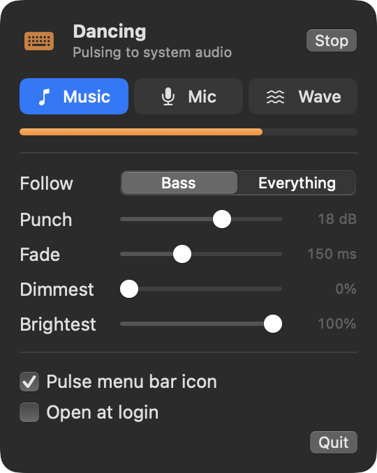

# kbdance

Make your MacBook's keyboard backlight dance. It pulses to whatever you're playing, to the microphone, or in a slow wave, from the menu bar or the command line.



- Flashes on the beat to anything your Mac plays: Spotify, Apple Music, YouTube, games
- Or follows the microphone, or a smooth sine, triangle or "breathe" wave
- Live controls for punch, fade, speed and brightness range
- Adapts to the volume, so quiet and loud tracks both use the full range
- Puts your brightness, auto-brightness and idle dimming back when it stops
- No dependencies. Audio is analyzed as it plays, never recorded or sent anywhere

The MacBook backlight is a single white zone, so the whole keyboard brightens and dims together. There are no colors or per-key effects, and external keyboards like the Magic Keyboard have no backlight at all.

## Install

Requires a MacBook with a backlit keyboard, macOS 14.2 or later, and Xcode 16 or later.

```sh
git clone https://github.com/omi0/kbdance.git
cd kbdance
./build-app.sh
```

This builds `KeyboardDance.app`, copies it to `~/Applications` and opens it. Click the keyboard icon in the menu bar and pick **Music**, **Mic** or **Wave**. The first time you pick Music or Mic, macOS asks whether Keyboard Dance may record system audio or use the microphone. Tick **Open at login** to keep it around after a restart.

## Command line

```sh
make install    # builds kbdance and copies it to ~/.local/bin
```

```sh
kbdance music                              # pulse to whatever the Mac is playing
kbdance mic                                # pulse to the microphone
kbdance wave --period 1.5 --shape breathe  # slow breathing light
kbdance music --range 12 --release 0.3     # harder flashes, slower fade
kbdance status                             # brightness, auto-brightness, idle dimming
kbdance restore                            # put things back after a force-quit
```

A live meter shows the level. Press Ctrl-C to stop.

| Option | Modes | Default | Effect |
| --- | --- | --- | --- |
| `--min`, `--max` | all | 0, 1 | Dimmest and brightest brightness |
| `--band bass\|full` | music, mic | bass for music, full for mic | Follow the kick drum, or overall loudness |
| `--range <dB>` | music, mic | 18 | Lower gives harder on/off flashes, higher gives subtler shading |
| `--release <sec>` | music, mic | 0.15 | How long the light takes to fall after a hit |
| `--gate <dB>` | music, mic | -60 music, -55 mic | Anything quieter counts as silence |
| `--period <sec>` | wave | 3 | Length of one cycle |
| `--shape` | wave | sine | `sine`, `triangle` or `breathe` |
| `--quiet` | all | | Don't draw the meter |

## How it works

**The backlight.** macOS has no public API for the keyboard backlight, so kbdance loads `KeyboardBrightnessClient` from the private CoreBrightness framework and sets the brightness instantly, 60 times a second, without saving each value as your preference. While it runs, it switches off auto-brightness and idle dimming so they don't fight the animation. It saves the original state to `~/Library/Application Support/kbdance/state.json` first, so it can be put back even after a crash.

**System audio.** A Core Audio process tap (macOS 14.2+) captures what every app plays, inside a private aggregate device. No real device's microphone gets opened, so AirPods don't switch into call mode.

**Beat following.** The audio is mixed to mono and, with Follow set to Bass, low-passed around 150 Hz to isolate the kick drum. Loudness is measured every 5 ms and placed in a decibel window whose top follows recent peaks, so quiet and loud tracks look the same. The light jumps up within one frame of a hit and falls back over the Fade time.

**Brightness curve.** The backlight's light output is linear in its brightness value, but eyes aren't. A gamma 2.2 curve makes waves and fades look even, while Dimmest and Brightest stay in real hardware units.

**Permissions.** macOS grants audio access to the *responsible process*. For a command-line tool that's normally the terminal, and a terminal that doesn't declare a reason to record system audio gets denied without any dialog. So `kbdance` re-launches itself as its own responsible process: the dialog names kbdance and it works in any terminal.

## Caveats

- kbdance relies on private macOS APIs (CoreBrightness and TCC). It checks that they exist and fails with a clear message rather than crashing, but a macOS update could still break it. Developed and tested on a MacBook Air (M2) running macOS 26.
- Builds are signed ad hoc, so macOS may ask for audio permission again after you rebuild.
- If the backlight is ever left in a strange state (say, after `kill -9`), run `kbdance restore`, or just open the app, which checks on launch.

## Development

```sh
swift build      # the library, the command-line tool and the app
swift test       # beat following, wave shapes and the brightness curve
./build-app.sh   # package, install and open the app
```

| Path | Contents |
| --- | --- |
| `Sources/KBDanceCore` | Backlight control, audio capture and analysis, and the 60 fps engine |
| `Sources/kbdance` | Command-line tool |
| `Sources/KeyboardDance` | Menu bar app (SwiftUI `MenuBarExtra`) |
| `Resources` | Info.plists for the app bundle and the command-line tool |

To regenerate the screenshot, build the app and run `.build/KeyboardDance.app/Contents/MacOS/KeyboardDance --snapshot screenshot.png`.

## License

[MIT](LICENSE)
